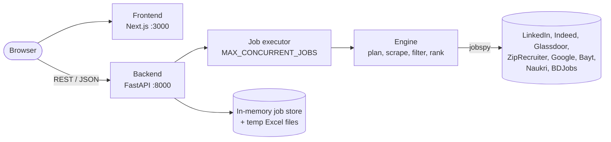
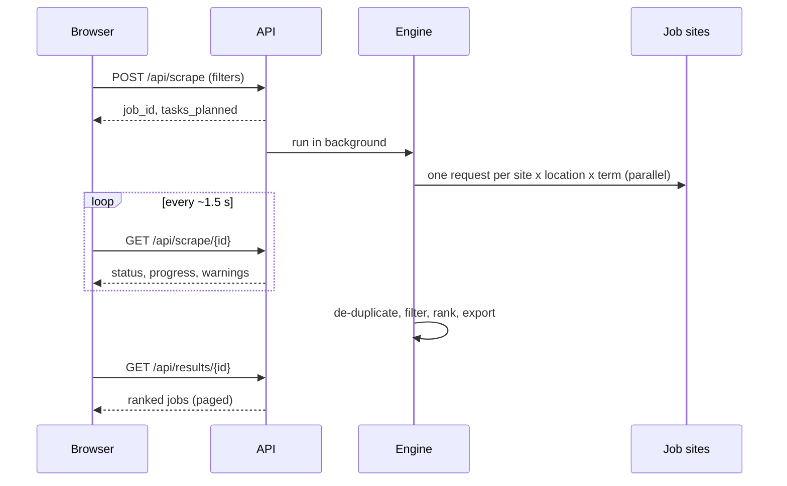

# Architecture

JobEscape is a small two-service app: a **Next.js** frontend and a **FastAPI** backend. The backend runs searches in the background, so the browser never waits on a slow request.

## Where things live

| File | Responsibility |
|---|---|
| `backend/main.py` | HTTP API, job store, background executor, cleanup of expired jobs, optional `X-API-Key` auth |
| `backend/engine.py` | Planning, scraping with retries, de-duplication, filters, ranking (no web framework code) |
| `backend/schemas.py` | The search request model and its validation |
| `backend/config.py` | Countries, per-site rules, seniority terms, settings read from environment variables |
| `backend/skills.py` | Cross-industry skill taxonomy and fast matching |
| `backend/resume.py` | Resume text extraction (PDF, DOCX, TXT) and profile detection |
| `backend/exporter.py` | Excel (with tracker dropdown and hyperlinks) and CSV export |
| `frontend/app/page.tsx` | The whole UI: search form, progress, results, resume upload |

## Life of a search

1. **Plan.** Countries and cities become regions. Each selected site is only used where it supports that region (for example ZipRecruiter only in the US and Canada, Naukri only in India). Bayt runs once per search term. The plan is capped at `MAX_TASKS_PER_JOB` requests, with high-traffic countries kept first.
2. **Scrape.** Requests run on a thread pool (`MAX_PARALLEL_TASKS`). Each site has its own shared limit across all searches (`SITE_RULES.max_parallel`) so many users can't hammer one site. Failed requests retry with backoff, and one failing site never fails the whole search; it becomes a warning.
3. **Clean.** Duplicates are removed by URL first, then by title, company and city, keeping the copy with the most information. This also merges the same job listed on two platforms.
4. **Filter.** Stages run in this order and each reports how many jobs remain (the "funnel" shown when a search returns nothing): posted window, work mode, job type, salary, experience level, keywords, title match, company.
5. **Rank.** Score = title match (phrase, then words) + keyword boosts + skills you have + recency + salary listed. Ties go to the newest job.
6. **Deliver.** Top N results are kept in memory, written to an Excel file in a temporary folder, and served as JSON, Excel, CSV or JSON download.

## Design decisions

- **Filters that a site can't do natively are done afterwards.** Indeed accepts only one of (age, job type + remote, easy apply) and LinkedIn only one of (age, easy apply). The engine sends the most selective one and enforces the others itself, so no filter is silently dropped.
- **Seniority is matched on the job title only.** "Reports to the senior manager" inside a description must not remove a junior role. Untagged titles are never dropped.
- **Unknown values are kept, not punished.** A job with no date or no salary stays unless the user asks for "require salary".
- **Skills use word boundaries.** `java` does not match `javascript`, and `c++` is not `c`.
- **No database.** Jobs and results live in memory and expire after `JOB_TTL_SECONDS`. This keeps self-hosting trivial and private, at the cost of losing running searches on restart.
- **One backend process.** Because state is in memory, run a single worker. Scaling out needs a shared store and a real queue (see the roadmap).

## Security model

- No accounts. Anyone who can reach the API can run searches from the server's IP address, so do not expose it publicly without protection (see `SECURITY.md`).
- Optional `API_KEYS` protects the API with an `X-API-Key` header and makes jobs private to their creator, but the bundled frontend does not send a key yet.
- Resumes are parsed in memory and never stored or logged.
